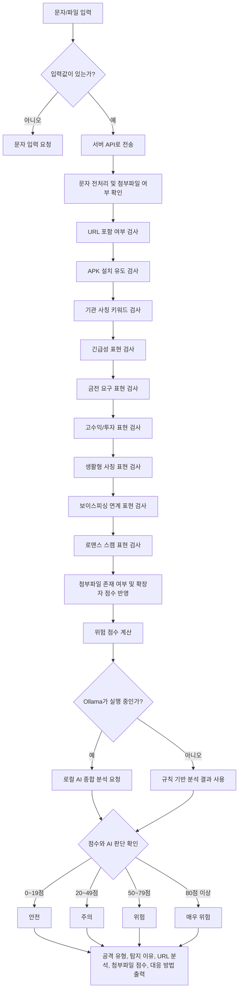

# 피싱 문자 탐지 순서도

## 1. 텍스트 순서도

```text
문자/파일 입력
  ↓
입력값 확인
  ↓
브라우저에서 서버 API로 전송
  ↓
문자 전처리 및 첨부파일 여부 확인
  ↓
URL 포함 여부 검사
  ↓
APK 설치 유도 검사
  ↓
기관 사칭 키워드 검사
  ↓
긴급성 표현 검사
  ↓
금전 요구 표현 검사
  ↓
고수익/투자 표현 검사
  ↓
생활형 사칭 표현 검사
  ↓
보이스피싱 연계 표현 검사
  ↓
로맨스 스캠 표현 검사
  ↓
첨부파일 존재 여부 및 확장자 점수 반영
  ↓
위험 점수 계산
  ↓
Ollama 로컬 AI 연결 여부 확인
  ↓
로컬 AI 종합 분석 또는 규칙 기반 분석 유지
  ↓
위험도 등급 분류
  ↓
공격 유형, 탐지 이유, URL 분석, 첨부파일 점수, 대응 방법 출력
```

## 2. Mermaid 순서도

아래 코드는 Mermaid를 지원하는 문서 편집기에서 그림 순서도로 볼 수 있다.


